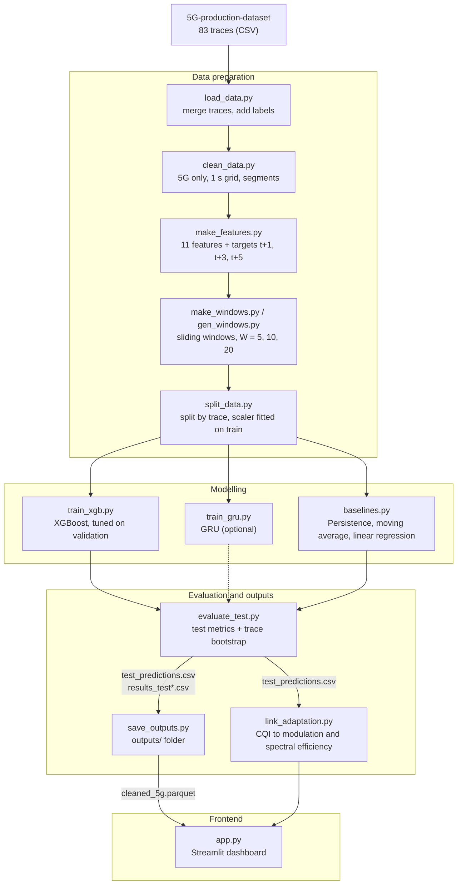
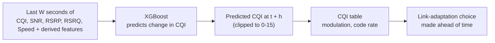

# Predicting 5G Channel Quality (CQI) for Proactive Link Adaptation

Major project: predict the 5G Channel Quality Indicator (CQI) **1, 3 and 5 seconds ahead** from recent radio measurements, and compare a **reactive** network (acts on the current CQI) with a **predictive** one (acts on the predicted CQI).

The project has two parts:

- **Pipeline:** Python scripts that clean a real 5G dataset, build features, train and evaluate models, and save the results.
- **Dashboard:** a Streamlit app that reads the saved results and shows reactive vs predictive decisions side by side. It never retrains anything.

---

## Why this matters

In 5G, the phone reports a CQI and the network uses it to choose a modulation and coding scheme. The channel keeps changing, especially while moving, so by the time data is sent the CQI is already old. Choosing too aggressively causes failed transmissions. Choosing too cautiously wastes capacity. Predicting CQI a few seconds ahead lets the network choose for the moment data is actually sent.

---

## Architecture



### How a prediction is used



---

## Dataset

- The raw traces are in `5G-production-dataset/5G-production-dataset/` (Netflix, Amazon Prime and Download sessions, Static and Driving). See the dataset's own files for its license and citation.
- **Loaded:** 83 traces, 188,711 rows.
- **After cleaning:** 145,056 rows, 81 traces, 237 continuous segments (5G only, one row per second). Two traces contain no 5G rows and are dropped.

## Method

| Item | Choice |
|---|---|
| Features (11) | CQI, SNR, RSRP, RSRQ, Speed, change in CQI and SNR, rolling mean and std (5 s) of CQI and SNR |
| Targets | CQI at t+1 s, t+3 s, t+5 s (one model per horizon) |
| Window | last 20 s (chosen on the validation set from 5, 10, 20) |
| Split | by trace, stratified by mobility: 57 train, 12 validation, 12 test traces |
| Scaling | `StandardScaler` fitted on training traces only |
| Baseline | Persistence: predict that CQI stays at its current value |
| Model | XGBoost on the flattened window, predicting the change from the current CQI, trained with absolute-error loss |
| Tuning | depth in {3, 5, 7}, number of trees by early stopping on validation |
| Reproducibility | fixed seed (42); the split is stored in `split.json` |

Splitting by trace (not by row) matters: neighbouring windows overlap almost completely, so a random row split would leak near-copies into the test set.

## Results (test traces only)

MAE and RMSE are in CQI levels (scale 0-15). Lower is better. Within ±1 is higher-is-better.

| Horizon | Persistence MAE | XGBoost MAE | Persistence RMSE | XGBoost RMSE | Within ±1 (Persistence / XGBoost) |
|---|---|---|---|---|---|
| 1 s | 0.739 | 0.739 | 1.684 | 1.684 | 81.3% / 81.3% |
| 3 s | 1.576 | 1.461 | 2.459 | 2.095 | 60.3% / 62.8% |
| 5 s | 1.770 | 1.616 | 2.640 | 2.223 | 55.8% / 58.0% |

MAE gain over Persistence, with a 95% interval from resampling whole traces:

| Group (test traces) | 3 s gain | 5 s gain | Traces better at 3 s / 5 s |
|---|---|---|---|
| All (12) | 0.115 [-0.067, 0.261] | 0.154 [-0.027, 0.306] | 8/12, 8/12 |
| Driving (8) | 0.064 [0.014, 0.138] | 0.117 [0.032, 0.233] | 6/8, 6/8 |
| Static (4) | 0.131 [-0.127, 0.318] | 0.165 [-0.095, 0.353] | 2/4, 2/4 |

**What this shows**

- At 1 s nothing beats Persistence. The final 1 s model is effectively Persistence.
- At 3 s and 5 s XGBoost lowers MAE by about 7-9% and RMSE by about 15%, so it mainly reduces large misses.
- The gain is statistically confirmed for Driving only. Overall and Static intervals include 0, because the test set is small.

---

## Repository layout

```
.
├── 5G-production-dataset/      raw traces (CSV)
├── load_data.py                step 1: merge traces
├── clean_data.py               step 2: clean, 5G filter, segments
├── make_features.py            step 3: features and targets
├── make_windows.py             step 4: sliding windows (W = 10)
├── gen_windows.py              step 4b: windows for W = 5 and 20
├── split_data.py               step 5: trace split and scaler
├── baselines.py                step 6: baseline models
├── train_xgb.py                step 7: tune and train XGBoost
├── train_gru.py                step 7 (optional): GRU
├── evaluate_test.py            step 8: test evaluation
├── save_outputs.py             step 9: collect outputs
├── link_adaptation.py          CQI to modulation, replay summaries
├── app.py                      Streamlit dashboard
├── split.json, best_config.json, scaler.pkl
├── results_*.csv, tuning_results_xgb.csv
├── models/                     trained models
└── outputs/                    cleaned_5g.parquet, test_predictions.csv, models, results
```

---

## Clone and run

Requires Python 3.10 or newer (developed on 3.12) and Git. Commands are for PowerShell on Windows; on macOS/Linux use `source .venv/bin/activate` instead of the activate line below.

### 1. Clone

```
git clone https://github.com/srushtilokhande12-web/Major5G.git
cd Major5G
```

If the scripts are inside a `5Gdataset/` folder in your clone, also run `cd 5Gdataset`. All commands below run from the folder that contains `app.py`.

### 2. Create an environment and install packages

```
python -m venv .venv
.venv\Scripts\activate
pip install pandas numpy scikit-learn joblib xgboost pyarrow streamlit altair
pip install torch          # only needed for the optional GRU
```

### 3A. Just open the dashboard

This uses the saved results in the repo. No training needed.

```
streamlit run app.py
```

The app opens at http://localhost:8501. If it says a file is missing, it names the script that creates it. It needs `test_predictions.csv` and `cleaned_5g.parquet` (in the project folder or in `outputs/`).

### 3B. Reproduce everything from the raw data

Run the scripts in this order. Large intermediate files (`*.pkl`, `*.npz`) are regenerated, so they are not needed from the repo.

```
python load_data.py          # expect 188711 rows, 83 traces
python clean_data.py         # expect 145056 rows, 81 traces, 237 segments
python make_features.py      # expect 144108 rows, 11 features
python make_windows.py
python gen_windows.py        # windows for W = 5 and 20
python split_data.py         # expect 57 / 12 / 12 traces
python baselines.py
python train_xgb.py          # tuning: a few minutes to about half an hour
python train_gru.py          # optional
python evaluate_test.py      # writes results_test.csv, results_test_gains.csv, test_predictions.csv
python save_outputs.py       # collects everything into outputs/
python link_adaptation.py    # optional: writes results_link_adaptation.csv
streamlit run app.py
```

The numbers after `expect` are what a correct run should print.

---

## Dashboard

`app.py` shows a reactive and a predictive scheme on the same test trace:

- **Controls:** test trace (shown as its dataset file), prediction horizon (1, 3 or 5 s), and model. These lists are read from the result files, so only horizons and models that were actually run appear.
- **Comparison table:** CQI, modulation, bits per symbol and spectral efficiency for Reactive, Predictive and Actual.
- **Charts:** modulation order and spectral efficiency over time for the three schemes.
- **Summary:** effective spectral efficiency and over-estimate rate for the selected trace and for all test traces.

All decision logic lives in `link_adaptation.py`, which `app.py` imports. Running that file directly produces the same numbers as a CSV.

## Limitations

- This is an **offline replay** of recorded traces, not a live network.
- The test set has only 12 traces (8 Driving, 4 Static), so group results are uncertain. Intervals are reported for that reason.
- The gain is modest and absent at 1 s.
- The link-adaptation replay is a simplified model: a choice above the actual CQI counts as a failed transmission. It does not simulate throughput or HARQ.
- The CQI-to-modulation table is the standard 3GPP 64QAM table. Check it matches the dataset's CQI definition before treating the modulation labels as exact.
- The GRU is optional and its results are not part of the tables above.

## License

See `LICENSE`.
